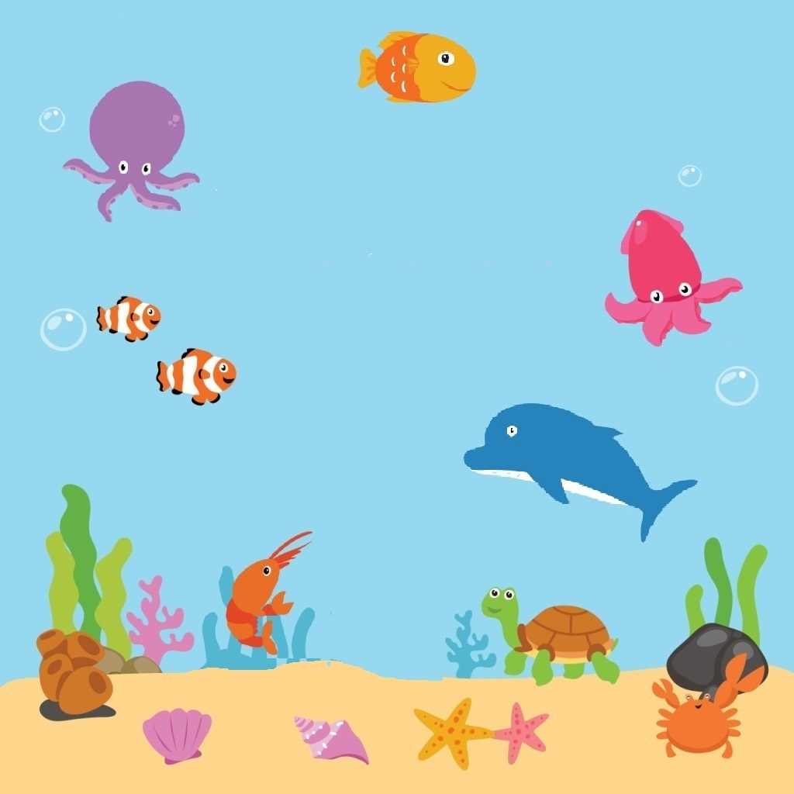

# 大鱼吃小鱼需求文档

> 来源：《高级语言综合实践课程设计指导书（含报告模板）》第 1 章相关部分
> 适用题目：题目 2 —— 大鱼吃小鱼（C 语言 + EasyX 图形库）

## 1. 项目概述

### 1.1 背景与目标

本课程设计通过一个趣味盎然的游戏程序的设计与实现，使学生亲身经历一个对初学者而言较为复杂的程序设计与开发过程。设计中需要熟练运用《高级语言综合实践》课程所学知识，理解并运用模块化程序设计的理念，初步体会软件工程的方法，同时自学用图形方式编写 C 语言程序，培养严谨的工作态度、良好的程序设计习惯和程序文档写作能力。

### 1.2 问题描述

用 C 语言编写一个简单的大鱼吃小鱼的游戏。用户通过键盘控制移动，躲避大鱼、吃掉小鱼，玩家在规定时间内通过吃掉小鱼达到目标分即获胜，闹钟可以增加时间，炸弹可以减少时间。

## 2. 总体任务要求

- **题目分配**：学号尾号为奇数做题目 1（黄金矿工），尾号为偶数做题目 2（大鱼吃小鱼）。本项目选择题目 2。
- 遵循软件开发过程的基本规范，运用模块化程序设计方法，按照题目要求分析、设计、编写、调试和测试 C 语言程序，并编写实践报告。
- 完成任务书中题目的【基本功能要求】，课设成绩约可得 80 分；要获得更高成绩需完成若干扩展功能，鼓励发挥想象力自行合理地增加其他扩展功能。
- 期中检查时需要完成至少包含大部分基本功能的程序和设计报告，否则影响期末成绩。
- 独立完成分配的题目，设计任务包括程序开发和编写课程设计报告两部分。
- 完成课程设计需要采用图形显示方式，涉及课程中未讲授的知识，应先自学图形方式相关内容（可参考 www.EasyX.cn）。推荐开发环境：Visual C++ + EasyX 图形库。

## 3. 主界面要求

1. 主界面分为三个区域：游戏区、按钮区和信息显示区。
2. 按钮区应包括游戏主要按钮，如开始、暂停、结束等。
3. 信息显示区至少需要显示玩家名、历史最高得分、当前得分、游戏倒计时等信息。

> 原文档图 2 左侧为游戏画面截图，右侧信息栏以文字示意：在此显示游戏相关信息，如玩家名、历史最高得分、当前得分、游戏倒计时等。

## 4. 基本功能要求

> 主界面布局要求见第 3 节。

### 4.1 具体要求

1. 程序运行时先出现系统登录界面，输入用户名等信息，然后进入主界面，主界面可参考图 2。
2. 点击“开始”按钮进入画面游戏开始，记分为 0 分，同时开始倒计时。
3. 游戏区中有很多种类、不同大小的鱼以不同的速度在游动，用户通过方向 ←、→、↓ 和 ↑ 键移动，吃掉小鱼、躲避大鱼和炸弹。
4. 两侧随机出现其他鱼，吃小鱼加分、玩家体积变大，与大鱼碰撞生命值减 1，吃到不同小鱼得分不同。
5. 随机出现闹钟，游戏过程中通过吃闹钟来增长游戏时间；随机出现炸弹，吃到炸弹则游戏时间减少。
6. 用户需要在有限时间内吃掉尽可能多的小鱼，获得尽可能高的得分。时间到则游戏结束，获得的总分数作为游戏的成绩。要求所有的鱼用链表实现存储与增删，节点结构体自行设计。程序要保障游戏画面始终有趣，每吃掉一条鱼要从游戏区的鱼列表中删除一条鱼，同时在吃掉的鱼列表中增加一条鱼，请合理设计数据结构。
7. 游戏结束，将玩家的信息写入文件。同学自行设计文件的数据内容和格式。

## 5. 扩展功能要求

1. 可以同时用鼠标控制游戏。
2. 鱼游到画面两端时处理恰当。
3. 使游戏画面更加流畅和逼真。
4. 自行添加各个游戏元素，提高游戏趣味性。
5. 能够显示玩家排行榜。
6. 增加生命模式，在生命值消耗完之前达到目标分即获胜，闹钟可以增加生命，炸弹可以减少生命。
7. 本作业是开放的作业，同学要打开思路，不拘一格，增加任何可行的附加功能。
8. 游戏创意可参照网上同名游戏。

## 6. 编程要求与重点强调

1. 整个游戏不求做到网络版本般的精细，只求逻辑差不多即可，有时会牺牲一些美观性，无妨；当然整个游戏越流畅越精美越好。有些功能不要过分纠结，差不多即可。
2. 用 C 语言完成本程序，可以用到面向对象的思想，但主要还要以最基本的 C 语言编写程序。
3. 在程序中要用到链表结构和文件读写，链表要实现插入、删除。
4. 禁止使用 goto 语句，尽可能少地使用全局变量，程序必须严格按照规范缩进，否则直接零分。
5. 要进行模块化编程，拆分好函数（不要整个程序只有一个函数，否则直接不及格；但也不要为了拆函数而拆函数），函数调用以及接口要合理，高内聚低耦合，要充分体会模块化程序设计的思想与带来的好处；报告中要画模块功能调用图。
6. 要先想再写，在编写函数前一定要想好整体架构、整体逻辑，然后再开始写程序。
7. 要学习自己进行程序纠错与调试；文档第三部分中的一些技术只是帮大家入门，要实现整个游戏还远远不够，因此要求多利用互联网资源。
8. 鼓励多多进行交流，但要保证每人都要独立完成程序。

## 7. 考核与成绩评定要点

- 成绩构成：100（课程设计总评成绩）= 60（程序运行情况）+ 30（课程设计报告）+ 10（平时成绩）。
- 程序设计与实现现场检查主要考查：是否符合题目要求、完全实现了基本功能要求；完成了哪些扩展功能要求；是否存在语法错误、逻辑错误及运行错误；程序设计是否合理、是否符合模块化程序设计的基本理念；程序是否具有良好的可读性和可靠性；用户界面是否友好。
- 课程设计报告主要考查：设计过程是否符合模块化程序设计方法的基本原则；报告内容是否完整（应包括附件 1 中要求的全部内容）；层次是否清楚、语言是否通顺；格式是否整洁漂亮。
- 总评不及格的情形包括：没有按照题目要求完成基本内容；没有按照要求编写课程设计报告；经教师考查表明课程设计不是自己独立完成；期中检查或期末检查不来、不交课程设计报告；期末检查随机提问多数回答错误；期末检查时现场修改或编写小程序不能在指定时间内独立完成；程序存在错误不能运行且不能在指定时间内独立修改正确；两位同学的课程设计报告和程序非常雷同（双方均不及格）。
