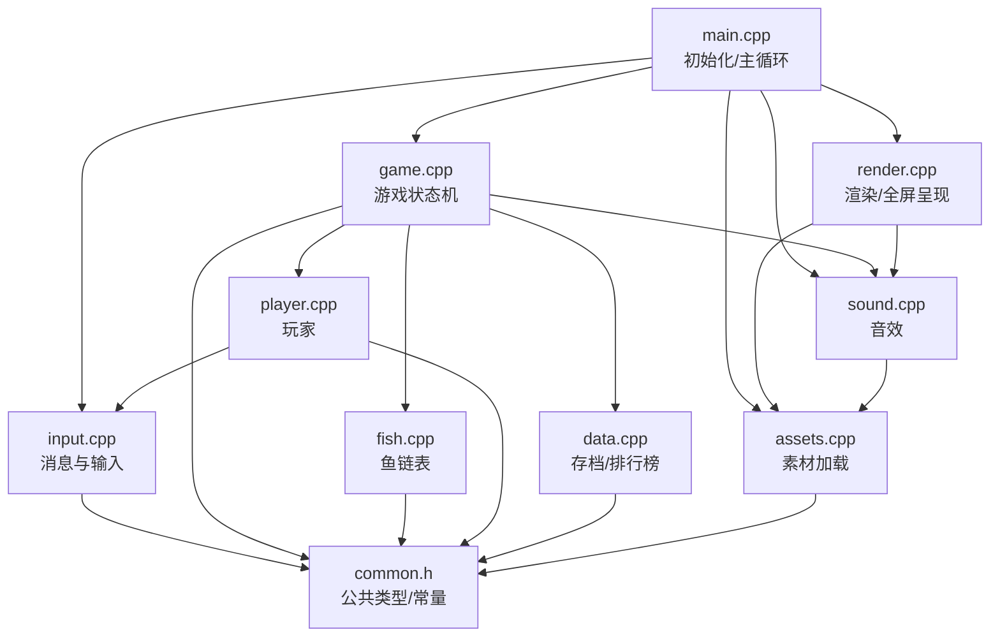
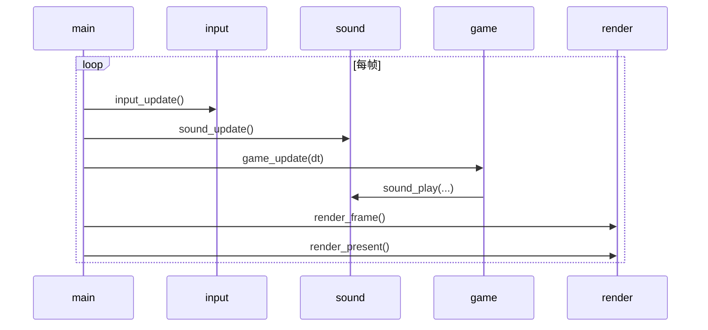
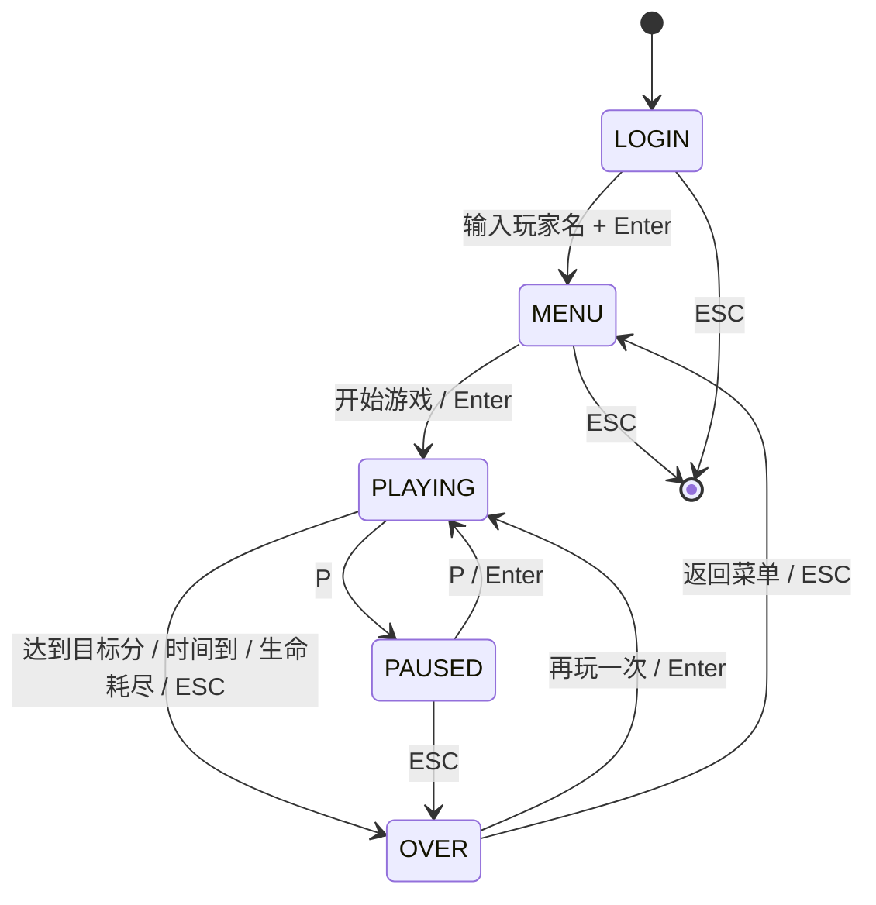

# 功能设计与模块调用关系

> 文档用途：课程设计报告「2 游戏程序总体设计」「3 游戏实现技术点分析」的素材整理
> 对应代码：`src/`（2026-11-15 版本）
> 适用题目：题目 2 —— 大鱼吃小鱼（学号尾号偶数）

## 1. 项目概况

`grow_fish` 使用 C 语言风格的过程式代码 + EasyX 图形库实现，源码以 `.cpp` 编译（EasyX 只支持 C++ 编译环境），但只使用结构体、函数、链表等 C 语言风格特性。开发环境为 Visual Studio Community 2022 + MSVC 14.44 + EasyX 26.10.25。

游戏启动后进入全屏，内部按 1024×720 设计，运行时按当前屏幕分辨率缩放呈现。

## 2. 课设要求完成情况

### 2.1 基本功能

| 课设要求 | 实现情况 |
| --- | --- |
| 系统登录界面，输入用户名 | 登录界面输入英文/数字玩家名，Enter 进入 |
| 主界面分游戏区、按钮区、信息显示区 | 顶部按钮区、左侧游戏区、右侧信息区 |
| 开始、暂停、结束按钮 | 三个按钮 + Enter/P/ESC 快捷键 |
| 信息区显示玩家名、最高分、当前分、倒计时 | 时间模式显示倒计时；生命模式显示生命模式说明；两种模式都显示玩家、最高分、当前分/目标分、生命、已吃鱼、排行榜 |
| 单击开始进入游戏并开始倒计时 | 时间模式下点击开始/Enter 后倒计时开始 |
| 矿工钩子左右摆动、↓ 发射（原题） | 本题改为玩家鱼移动；方向键/WASD/鼠标按住控制 |
| 不同大小、数量不定、随机分布的金块/石块 | 不同鱼种、随机大小/速度、左右两侧随机出现 |
| 抓取分数不同、重量影响回缩速度 | 小鱼按体型给 1~3 分；大鱼为危险物 |
| 所有金块/石块用链表存储 | 所有鱼使用 `FishList` 单链表存储与增删 |
| 游戏结束写入玩家信息 | 每局写 `last_game.txt`；正分同时写 `records.txt` 排行榜 |
| 限时达到目标分过关 | 时间模式 60 秒内达到 20 分过关 |
| 时间归零游戏结束 | 时间模式倒计时归零判负 |
| 扩展：鼠标控制 | 按住鼠标左键，玩家鱼游向鼠标位置 |
| 扩展：画面流畅逼真 | 自绘 1024×720 画布 + 全屏缩放；双缓冲画布；Kenney 精灵图 |
| 扩展：更多游戏元素 | 闹钟、炸弹、生命值、无敌时间、浮动得分提示、音效 |
| 扩展：排行榜 | 信息区显示前 5 名，数据来自 `records.txt` |
| 扩展：生命模式 | 无时间限制；闹钟 +1 命、炸弹 -1 命，生命耗尽前达标即过关 |
| 扩展：鱼游到两端处理 | 大鱼到边缘掉头一次，小鱼偶尔掉头；掉头有 whoosh 音效 |
| 扩展：BUG/演示模式 | Ctrl+B 开关：大鱼不造成伤害、计时冻结、不触发达标/超时结束；仍可手动结束 |

### 2.2 编程规范

- 未使用 `goto`；
- 游戏状态集中在 `Game` 结构体中，模块内部只有渲染画布、素材、声音开关等少量静态状态；
- 按输入、状态机、鱼链表、玩家、渲染、存档、素材、声音拆分模块；
- 函数职责清晰，主循环中按「输入 → 逻辑 → 渲染 → 呈现」顺序调用。

## 3. 源码模块划分

| 文件 | 职责 | 关键函数/内容 |
| --- | --- | --- |
| `src/main.cpp` | 初始化、DPI/全屏窗口、主循环 | `main`、`initgraph`、`render_present` 调用 |
| `src/common.h` | 公共常量、枚举、结构体 | `Fish`、`FishList`、`Player`、`Popup`、`GameMode` |
| `src/input.cpp/h` | 消息泵、键盘/鼠标/字符输入 | `input_update`、`input_down`、`input_pressed` |
| `src/game.cpp/h` | 游戏状态机、碰撞、计时、模式、存档触发 | `game_init`、`game_update`、`game_start_round`、`game_finish` |
| `src/fish.cpp/h` | 鱼链表、生成、移动、掉头、删除 | `fishlist_spawn`、`fishlist_update`、`fishlist_detach`、`fishlist_remove` |
| `src/player.cpp/h` | 玩家移动、鼠标跟随、成长、无敌 | `player_init`、`player_update`、`player_move_toward`、`player_refresh_size` |
| `src/render.cpp/h` | 画布绘制、全屏呈现、精灵、UI、浮动文字 | `render_init`、`render_present`、`render_frame`、`draw_sprite` |
| `src/data.cpp/h` | 排行榜与每局结果文件 | `data_load`、`data_save`、`data_save_last_game` |
| `src/assets.cpp/h` | 图片加载、水平翻转、路径查找 | `assets_init`、`assets_get`、`assets_find` |
| `src/sound.cpp/h` | 环境音循环、短音效、开关 | `sound_init`、`sound_update`、`sound_play`、`sound_set_enabled` |

## 4. 模块调用关系图



主循环调用顺序：



## 5. 游戏状态机



说明：菜单状态下按 M 在「时间模式」与「生命模式」之间切换；按 S 开关音效；游戏中按 Ctrl+B 开关 BUG/演示模式。

## 6. 主要数据结构

```c
typedef enum {
    FISH_SMALL, FISH_BIG, FISH_BOMB, FISH_CLOCK
} FishType;

typedef struct Fish {
    FishType type;
    float x, y;
    float vx, vy;
    float halfW, halfH;
    int size;
    int score;
    int variant;        /* 精灵图变体 */
    int turnsLeft;      /* 剩余掉头次数 */
    bool justTurned;    /* 本帧是否刚掉头（用于播放音效） */
    bool alive;
    struct Fish* next;
} Fish;

typedef struct {
    Fish* head;
    Fish* tail;
    int count;
} FishList;

typedef struct {
    wchar_t name[MAX_NAME];
    float x, y;
    float halfW, halfH;
    int size;
    int dir;            /* 1 向右，-1 向左 */
    int lives;
    int score;
    bool alive;
    DWORD invulnUntil;
} Player;

typedef struct {
    float x, y;
    wchar_t text[32];
    COLORREF color;
    DWORD born;
} Popup;

typedef struct {
    GameState state;
    GameMode mode;
    Player player;
    FishList fish;      /* 活动鱼链表 */
    FishList eaten;     /* 已吃鱼链表 */
    float timeLeft;
    int targetScore;
    int highScore;
    ScoreRecord records[MAX_RECORDS];
    int recordCount;
    float spawnTimer;
    float animTime;
    bool win;
    bool recordSaved;
    /* 登录、浮字、视口等状态 */
} Game;
```

链表操作要点：

- `fishlist_spawn`：从左右两侧生成鱼，按类型设置大小、速度、分值、掉头次数；
- `fishlist_update`：移动、上下边界反弹、左右边缘掉头、出界删除；
- `fishlist_detach`：从活动链表摘下节点但不释放；
- 吃掉小鱼时：活动链表 `detach` → 加入 `eaten` 链表，满足「从游戏区删除、加入已吃列表」的要求；
- 大鱼、炸弹、闹钟：直接 `fishlist_remove` 释放。

## 7. 关键模块函数清单

```c
/* main.cpp */
int main(void);

/* input.cpp */
void input_init(Input* in);
void input_update(Input* in);
bool input_down(const Input* in, int vk);
bool input_pressed(const Input* in, int vk);

/* game.cpp */
void game_init(Game* g, int viewW, int viewH);
void game_update(Game* g, Input* in, float dt);
void game_start_round(Game* g);
void game_to_menu(Game* g);
void game_finish(Game* g, bool win);

/* fish.cpp */
void fishlist_init(FishList* list);
void fishlist_clear(FishList* list);
void fishlist_append(FishList* list, Fish* fish);
Fish* fishlist_detach(FishList* list, Fish* fish);
void fishlist_remove(FishList* list, Fish* fish);
Fish* fishlist_spawn(FishList* list, float gameW, float gameH);
void fishlist_update(FishList* list, float dt, float gameW, float gameH);

/* player.cpp */
void player_init(Player* p, const wchar_t* name);
void player_update(Player* p, const Input* in, float dt);
void player_move_toward(Player* p, float tx, float ty, float dt);
void player_refresh_size(Player* p);
bool player_invulnerable(const Player* p);

/* render.cpp */
void render_init(int screenW, int screenH);
void render_present(void);
void render_frame(const Game* game);
void render_button(int x, int y, int w, int h, const wchar_t* label,
                   bool hover, bool enabled);

/* data.cpp */
void data_load(ScoreRecord records[], int* count);
void data_save(ScoreRecord records[], int* count, const wchar_t* name, int score);
void data_save_last_game(const wchar_t* name, int score, bool win, int mode);
int data_high_score(const ScoreRecord records[], int count);

/* assets.cpp */
void assets_init(void);
bool assets_ok(void);
IMAGE* assets_get(SpriteId id, bool facingLeft);
IMAGE* assets_bg(BackgroundSprite id);
bool assets_find(const wchar_t* rel, wchar_t* out, int cap);

/* sound.cpp */
void sound_init(void);
void sound_update(void);
void sound_shutdown(void);
void sound_play(const wchar_t* name);
void sound_set_enabled(bool enabled);
bool sound_is_enabled(void);
```

## 8. 关键实现技术点

### 8.1 全屏呈现与鼠标映射

- 内部画布固定为 1024×720，所有 UI/游戏坐标按设计尺寸计算；
- `render_present` 先通过 `StretchBlt` 将画布拉伸到全屏 `IMAGE`，再用 EasyX `putimage` 呈现到窗口；
- 鼠标消息坐标为全屏像素，`game_update` 中按 `WIN_W/viewW`、`WIN_H/viewH` 映射回设计坐标，按钮与鼠标控制均使用映射后的坐标；
- 程序调用 `SetProcessDPIAware` 并禁用 IME，避免 Windows 缩放和输入法候选框干扰。

### 8.2 透明精灵图

- 鱼类/玩家/水草/岩石来自 Kenney Fish Pack 2.0（PNG，带 alpha）；
- 使用 `AlphaBlend` + `AC_SRC_ALPHA` 将精灵绘制到画布，支持透明背景和缩放；
- 为左右游动方向预先复制水平翻转的 `IMAGE`，避免每帧翻转；
- 素材缺失时自动回退到 EasyX 几何图形绘制，保证程序可运行。

### 8.3 音效

- `tools/gen_sounds.py` 用 Python 标准库生成原创 WAV，无第三方版权；
- 环境音使用 MCI 打开并播放，`sound_update` 每秒检查状态，停止后自动续播；
- 吃鱼、撞鱼、炸弹、闹钟、掉头、胜负、按钮使用 `PlaySound` 异步播放；
- 按 S 开关音效，关闭时暂停环境音并停止当前音效。

### 8.4 文件设计

| 文件 | 内容 | 写入时机 |
| --- | --- | --- |
| `records.txt` | `玩家名<TAB>得分`，按得分降序，最多 10 条，UTF-8 | 得分 > 0 的游戏结束 |
| `last_game.txt` | 玩家、得分、结果、模式、时间，UTF-8 | 每局结束（含 0 分） |

两个文件均在 `.gitignore` 中忽略，运行目录生成。

## 9. 数值与难度

| 参数 | 当前值 | 位置 |
| --- | --- | --- |
| 目标分 | 20 | `common.h` |
| 时间模式时长 | 60 s | `common.h` |
| 初始生命 | 3 | `common.h` |
| 活动鱼上限 | 24 | `common.h` |
| 生成间隔 | 0.35~0.95 s | `game.cpp` |
| 小鱼概率 | 65% | `fish.cpp` |
| 大鱼概率 | 15% | `fish.cpp` |
| 炸弹概率 | 10% | `fish.cpp` |
| 闹钟概率 | 10% | `fish.cpp` |
| 小鱼分值 | 1~3（按体型） | `fish.cpp` |
| 小鱼速度 | 75~150 px/s | `fish.cpp` |
| 大鱼速度 | 35~70 px/s | `fish.cpp` |
| 玩家速度 | 330 px/s | `player.cpp` |
| 被撞无敌时间 | 1.5 s | `game.cpp` |
| 每 5 分成长一级 | 1~5 级 | `player.cpp` |

难度可在上述位置调整；当前数值保证 60 秒内有机会达到 20 分，同时保留一定挑战。

## 10. 测试记录

| 测试项 | 方法 | 结果 |
| --- | --- | --- |
| Debug/Release × Win32/x64 构建 | MSBuild 四套配置 | 全部通过 |
| 登录流程 | 输入 Tom + Enter | 进入主界面，玩家名正确 |
| 时间模式 | 开始/暂停/结束、倒计时 | 倒计时递减，暂停冻结，结束进入结算 |
| 生命模式 | M 切换后开始 | 无倒计时，显示生命模式说明；闹钟/炸弹按生命结算 |
| 鼠标控制 | 按住鼠标移动到游戏区 | 玩家鱼朝鼠标游动，方向翻转正确 |
| 吃鱼加分 | 自动巡游 | 得分/已吃鱼增加，浮动 `+N` 出现 |
| 碰撞 | 撞大鱼/炸弹/闹钟 | 扣生命/减时间/加时间，浮字与音效触发 |
| 掉头 | 鱼游到边缘 | 大鱼掉头，`justTurned` 触发 whoosh |
| 文件存档 | 结束游戏 | `records.txt` 与 `last_game.txt` 写入 |
| 排行榜 | 重启后登录 | 最高分/前 5 名正确加载 |
| 全屏 | 2560×1600 屏幕 | 无边框铺满，鼠标映射正确 |
| 素材透明 | Kenney PNG | 透明背景正常，无黑框 |
| 音效 | 生成 9 个 WAV | 文件可读，MCI/PlaySound 调用成功，程序稳定 |
| BUG 模式 | Ctrl+B 后撞大鱼、等待计时 | 生命不变，时间显示 ∞，关卡不自动结束；再次 Ctrl+B 可关闭 |

## 11. 已知限制与后续可扩展点

1. 目前只有单局目标分，没有多关卡/难度递增；后续可按关卡提高目标分、鱼速和危险物比例。
2. 炸弹/闹钟仍为 EasyX 几何图标，可替换为更多 Kenney 或自绘图标。
3. 音效只有开关，没有音量滑杆；可使用 MCI/波形音量接口扩展。
4. 鱼的运动为直线 + 上下反弹 + 偶尔掉头，没有鱼群、逃跑、追逐等 AI。
5. 没有手柄支持、没有移动端版本；课程设计要求以 PC + EasyX 为主。
6. 报告可继续补充界面截图、模块调用图和测试用例表。

## 12. 素材与许可

- 鱼类、水草、岩石、气泡：Kenney Fish Pack 2.0，CC0 1.0，来源 <https://kenney.nl/assets/fish-pack>，详见 `assets/fish/License.txt`。
- 音效：`tools/gen_sounds.py` 程序化生成，原创 CC0，无第三方采样。
- 参考代码：`refer/BigFishEatSmallFish/` 仅作玩法与视觉参考，未复用代码；该目录已 gitignore。
